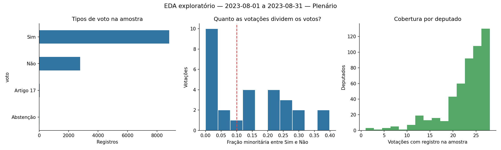
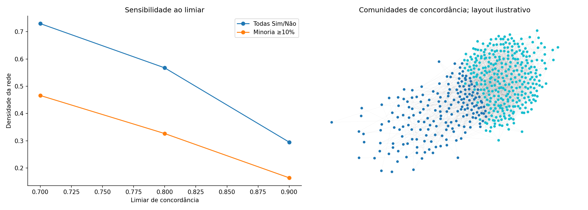
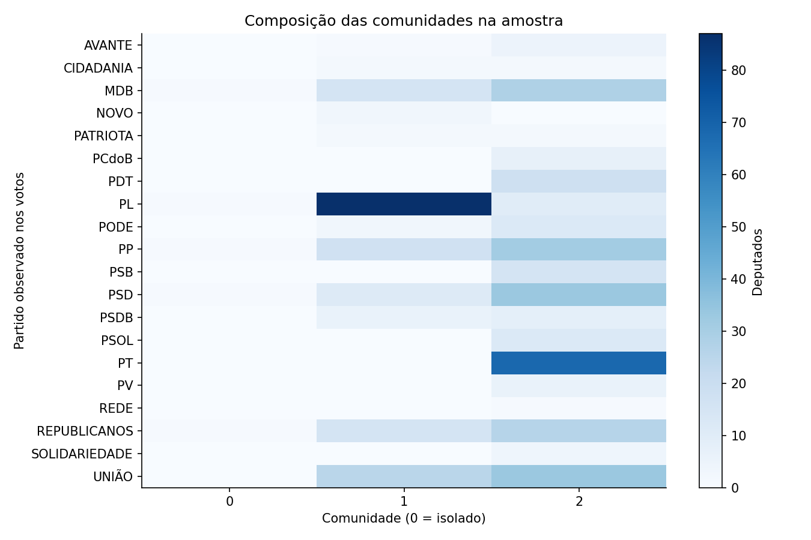

# EDA da API da Câmara — material para orientação

**Execução em 21/10/2026. Tema ainda em definição.**

## O que está pronto

Foi realizado um EDA de descoberta e viabilidade, consultando diretamente a API, sem exportação anual.
O resultado permite discutir perguntas de pesquisa, verificar a qualidade dos vínculos e escolher quais dados extrair depois.
O universo consultado não equivale a toda a atividade parlamentar. A análise quantitativa principal usa o Plenário de **01 a 31/08/2023**, mesmo mês do código preexistente.

Foram observados **11,662 registros de voto, 513 deputados e 28 decisões com registros individuais**.
Há **13 decisões quase consensuais** pelo critério exploratório de menos de 10% no lado minoritário entre Sim e Não.
O piloto está concluído como diagnóstico inicial; a análise definitiva depende da escolha do tema, do período e dos critérios com o orientador.

## 1. Aproveitamento do trabalho existente e mudança de direção

O código de `rede_votacoes.py` já consultava a API. A demora não decorria de uma exigência de usar arquivos locais:
`exportar_votacoes.py` percorre um ano e busca os votos de cada decisão sequencialmente.
O novo fluxo usa consultas delimitadas, até três tarefas simultâneas, paginação com controle de cobertura e cache de respostas.
Consulta de API também transfere dados, mas aqui somente o recorte explorado é guardado; o cache evita repetir essas transferências.

Foram aproveitados concordância entre pares, mínimo de votos em comum, Louvain com semente fixa e exportação GraphML.
O novo código usa o ID numérico do deputado e testa diferentes critérios. A implementação anterior usava nome e partido como identidade, o que pode separar uma mesma pessoa quando a sigla muda.
Todos os arquivos antigos foram preservados. `REGISTRO_MUDANCA_TEMA.md` registra que o LEN e o antigo cronograma são históricos; não foram transportados como objetivos do novo trabalho.

## 2. Que dados foram efetivamente consultados

| Dados | Registros | Cobertura |
| --- | --- | --- |
| Deputados em exercício no intervalo | 523 | Paginação completa para o filtro; não são 523 cadeiras simultâneas |
| Registros de votações do Plenário | 141 | Paginação completa do mês; tipos de decisão variados |
| Registros individuais de voto | 11662 | 28 das 36 decisões consultadas; 8 retornaram lista vazia |
| Projetos de lei apresentados no mês | 100 | Primeira página; há mais páginas; não é total do mês |
| PL com autores, temas e tramitações consultados | 12 | Selecionados entre os primeiros 100 PL |
| Eventos | 99 | Primeira página retornada; há mais páginas |
| Registros de presença em três eventos | 88 | Exploração do relacionamento; não é frequência parlamentar |
| Referências de temas | 32 | Lista de categorias oficiais disponível |
| Despesas de três deputados no mês | 0 | HTTP 200 com lista vazia; disponibilidade inconclusiva |

Deputado, votação, proposição, órgão e evento têm identificadores que permitem cruzamentos.
Votos se relacionam com deputados e votações; votações com órgãos, eventos e possíveis proposições; proposições com autores, temas e tramitações.
O campo de objeto da votação está vazio em **98 de 141 registros (69,5%)** na listagem deste mês. O endpoint de detalhes pode apresentar objetos possíveis e proposições afetadas, o que não garante uma associação unívoca ao projeto efetivamente votado.

## 3. Seleção do piloto e limites de cobertura

As 141 entradas do catálogo mensal foram paginadas por completo. Entre elas, 31 tinham descrição com padrão de placar “Sim: número”.
Foram sorteadas 30 dessas entradas com semente 42 e seis das outras 110 com semente 43.
O indicador textual serve apenas para priorizar consultas; **não classifica oficialmente o método de votação**.
As 36 consultas retornaram HTTP 200; 28 tinham votos e oito tinham lista vazia. Registros com votos também não garantem, por si sós, uma votação nominal completa.

Para proposições, foram selecionados 12 PL entre os primeiros 100 IDs retornados do mês. Eventos foram limitados à primeira página.
Esses recortes não são amostras representativas da legislatura; não fundamentam rankings gerais, conclusões sobre ideologia, influência causal ou conduta parlamentar.
Foram registradas 119 consultas de aplicação no manifesto da execução de referência. A reexecução offline recuperou todas do cache, sem acesso à rede.
O cache mantém a data de cada resposta; os dados podem ser corrigidos ou atualizados pela fonte posteriormente.

## 4. Qualidade e preparo dos dados

- **Identidade:** zero IDs ausentes nos 11662 registros de voto e zero duplicatas da chave votação–deputado na amostra.
- **Partido:** três IDs aparecem com mais de uma sigla; isso exige tratamento temporal ou verificação cadastral. O resumo de comunidades usa a última sigla observada nos votos do período, não a sigla atual do cadastro.
- **Ausência:** quem não tem voto registrado em uma decisão não entra no denominador daquele par. Isso não é automaticamente ausência física nem discordância.
- **Tipos de voto:** foram observados Sim (8831), Não (2788), Artigo 17 (26) e Abstenção (17). O EDA compara todos os tipos com a versão binária.
- **Temporalidade:** a documentação distingue a data da decisão do momento de registro no sistema. Uma análise temporal deve explicitar qual campo usa; não se inferiu influência pela ordem de registro de votos.
- **Despesas:** as consultas históricas de três IDs retornaram listas vazias. Checagens adicionais em outro ID e sem filtro de mês também retornaram vazias. A causa não foi estabelecida; não se tratou isso como gasto zero nem como indisponibilidade universal da base.

`qualidade_campos.csv` mostra a ausência de valores por campo; `cobertura_consultas.csv` distingue listas completas, parciais, vazias e falhas.
No piloto não houve HTTP 404 nem erro de consulta. O cliente e os testes tratam esses casos separadamente de uma resposta vazia bem-sucedida.

## 5. O que a rede de votos mostrou

Para cada par, **concordância = votos iguais / decisões em que ambos têm voto registrado**.
Na versão binária, somente Sim/Não entram nesse cálculo. A rede é não direcionada, com aresta quando a taxa alcança o limiar e há observações comuns suficientes.
Foram testados limiares de 70%, 80% e 90%, mínimos de 5, 10 e 20 observações comuns e três tratamentos de voto.
Os critérios de 10% de minoria, 70% de concordância e mínimo de cinco são exploratórios, não escolhas metodológicas definitivas.

**Redes de referência: limiar 70%, mínimo de cinco decisões compartilhadas.**

| Tratamento | Votações | Nós | Arestas | Densidade | Comunidades | Modularidade |
| --- | --- | --- | --- | --- | --- | --- |
| Todos os tipos | 28 | 513 | 94926 | 0.723 | 2.000 | 0.109 |
| Somente Sim/Não | 28 | 513 | 95805 | 0.730 | 2.000 | 0.109 |
| Sim/Não e minoria >=10% | 15 | 512 | 60978 | 0.466 | 3.000 | 0.219 |

A comunidade é calculada sobre os nós com pelo menos uma aresta; isolados são informados separadamente.
Modularidade descreve a separação encontrada pelo algoritmo. Não é acurácia, teste de significância nem confirmação de grupos políticos reais.
As tabelas também trazem o índice de Rand ajustado entre comunidades e a partição por partido; ele mede correspondência, sem tratar partido como verdade de referência.

O resultado principal é metodológico: a rede é sensível ao recorte. Com Sim/Não, a densidade foi de **72,95% para 46,61%** quando se restringiu a 15 decisões com minoria ≥10%.
Os universos têm 513 e 512 nós, respectivamente; os números de observações e isolados também mudam. A diferença não é uma estimativa causal do efeito do consenso.
A transição de duas para três comunidades é uma observação do algoritmo neste piloto, que ainda deve ser testada em outros períodos e parâmetros.





Na visualização da rede foram desenhadas no máximo 1.800 arestas para manter a figura legível. Os cálculos usam todas as arestas.
A posição no desenho é ilustrativa; não representa distância política medida.



## 6. Outras possibilidades verificadas

**Orientações:** 24 decisões com votos tiveram orientações consultadas. As lideranças individuais de partido cobrem somente PL e NOVO no recorte; as demais orientações são de blocos.
Existem 1836 votos binários diretamente comparáveis, **15,8%** do total Sim/Não.
A adesão foi de **89,3% apenas nessa parcela**. Não é a taxa de disciplina da Câmara nem uma comparação equilibrada entre partidos.
É necessário resolver blocos e federações com composição histórica antes de ampliar essa medida. Ausência de orientação direta não é desobediência.

**Proposições:** todos os 12 PL consultados têm tema e autor. Cada um trouxe apenas um autor; portanto este recorte não produziu relações de coautoria.
Há 147 registros de tramitação consultados, que podem avançar além de agosto/2023.
São históricos das proposições consultados hoje, não uma fotografia do que já era conhecido naquele mês.
Para predição de tramitação ou aprovação, seria indispensável escolher uma data de corte e evitar usar informações posteriores a ela.

**Eventos:** há vínculo entre evento e deputados listados, com 88 registros nos três eventos inspecionados.
Antes de estudar participação, é preciso distinguir eventos cancelados, tipos de evento e cobertura dos registros; não foi calculada taxa geral de presença.

## 7. Opções para decidir o tema com o orientador

| Caminho | Pergunta possível | Evidência do piloto | Próximo recorte | Condição |
| --- | --- | --- | --- | --- |
| 1. Robustez de comunidades de concordância | Quanto a estrutura das comunidades muda com o consenso das votações e os critérios de construção da rede? | Densidade 0,730 → 0,466 e 2 → 3 comunidades ao usar apenas decisões com minoria ≥10%, no parâmetro de referência. | Repetir em alguns meses completos; comparar limiares, cobertura e estabilidade; controlar objetos/sessões repetidos. | Maior aproveitamento do código atual. A contribuição precisa ser confirmada pela literatura; o piloto não prova novidade. |
| 2. Evolução temporal de afinidades de voto | As afinidades entre deputados e as comunidades se mantêm ou mudam ao longo dos meses? | IDs e datas permitem estruturar janelas; foram observadas três pessoas com mais de uma sigla nos votos. | Meses com cobertura suficiente; alinhar deputados presentes e filiação por período; comparar janelas. | Viável como continuação, mas o EDA de um mês ainda não demonstra mudança temporal. |
| 3. Adesão às orientações de bancada | Como a adesão dos deputados varia por bancada e por tipo de votação? | Há orientações, mas o vínculo direto identifica somente PL e NOVO e cobre 15,8% dos votos Sim/Não. | Resolver blocos/federações e suas composições históricas; medir cobertura antes de comparar partidos. | Depende de trabalho adicional de integração; 89,3% é apenas a taxa da parcela comparável. |
| 4. Temas e textos das proposições | É possível organizar ou classificar ementas pelos temas oficiais da Câmara? | Os 12 PL consultados têm temas; há 32 categorias de referência e ementas no catálogo. | Um conjunto delimitado de PL; verificar distribuição de classes e rótulos múltiplos; separar treino/teste por tempo se houver predição. | Alternativa se desejarem IA textual; o piloto não valida um modelo nem a consistência de todos os rótulos. |
| 5. Coautoria ou rede deputado–fornecedor | Que relações de coassinatura ou compartilhamento de fornecedores podem ser estudadas? | Os 12 PL têm somente um autor cada; as três consultas de despesas retornaram vazias. | Investigar proposições com múltiplas assinaturas; confirmar disponibilidade de despesas e seus campos. | Ainda sem evidência suficiente neste piloto. Lista vazia não significa gasto zero; centralidade não demonstra irregularidade. |

Minha leitura do piloto é que **robustez das comunidades** e **evolução das afinidades de voto** são os caminhos com maior reaproveitamento imediato.
Isso é uma avaliação de viabilidade técnica, não uma escolha de tema nem garantia de contribuição inédita.
Uma pesquisa científica ainda precisa de problema delimitado, comparação com trabalhos anteriores e um protocolo que permita responder à pergunta escolhida.

## 8. Decisões para a orientação de hoje

1. O TCC deve manter grafos como núcleo ou pode explorar temas e textos de proposições?
2. É suficiente uma contribuição experimental sobre construção e estabilidade das redes, ou será exigida uma tarefa preditiva de IA?
3. Qual pergunta deve guiar o trabalho: robustez das comunidades, mudança temporal ou adesão às bancadas?
4. Qual recorte é realizável: Plenário, quais meses/anos, quais tipos de decisão e quantas observações mínimas por deputado?
5. Como tratar decisões quase consensuais, abstenções, múltiplas decisões da mesma proposição e mudanças de partido?
6. Quais entregas e datas passam a valer depois da mudança de tema? O cronograma anterior não foi reaplicado automaticamente.

Proposta objetiva para levar: “Já verificamos o acesso aos dados e construímos um piloto reproduzível. As comunidades mudam conforme os critérios de construção da rede. Queremos decidir se essa sensibilidade será a pergunta central ou se ampliaremos para comparar sua evolução entre períodos.”

## 9. Como reproduzir e continuar

```bash
python -m pip install -e '.[camara,notebook]'
python DEPUTADOS/eda_api.py
python DEPUTADOS/eda_api.py --offline
python -m unittest discover -s DEPUTADOS -p 'test_eda_api.py' -v
```

O notebook `eda_camara_api.ipynb` contém a análise e saídas executadas. Sua opção padrão abre os resultados guardados, sem nova coleta; ativar `RECOLETAR` consulta o recorte pela API.
A opção offline exige o cache local da primeira execução; no repositório ele é ignorado, para não versionar respostas brutas em massa.
Os CSV e gráficos publicados permitem examinar os resultados sem baixar novamente a API; o manifesto identifica as URLs originais para uma nova coleta.
Depois da orientação, modificar somente os filtros ligados à pergunta escolhida e então extrair a base definitiva. Não foi treinado um modelo nem determinada uma metodologia final nesta etapa.

## Fontes e rastreabilidade

- Código preexistente examinado no commit `16adb81230293d4a02ab70c83dceb86e4241ae32`, pasta [DEPUTADOS](https://github.com/Mendes1801/deteccao_precoce_campanhas_coordenadas_grafos/tree/16adb81230293d4a02ab70c83dceb86e4241ae32/DEPUTADOS).
- [Especificação oficial OpenAPI](https://dadosabertos.camara.leg.br/api/v2/api-docs).
- [Consulta e documentação da API](https://dadosabertos.camara.leg.br/swagger/api.html).
- [Explicações oficiais dos dados de votações](https://dadosabertos.camara.leg.br/howtouse/2020-02-07-dados-votacoes.html).
- Evidência empírica: `manifesto_consultas.csv`, `cobertura_consultas.csv`, `resumo.json` e respostas locais em cache.

Os números descritivos deste relatório foram calculados a partir das respostas consultadas. As opções de tema são interpretações e propostas para discussão.
